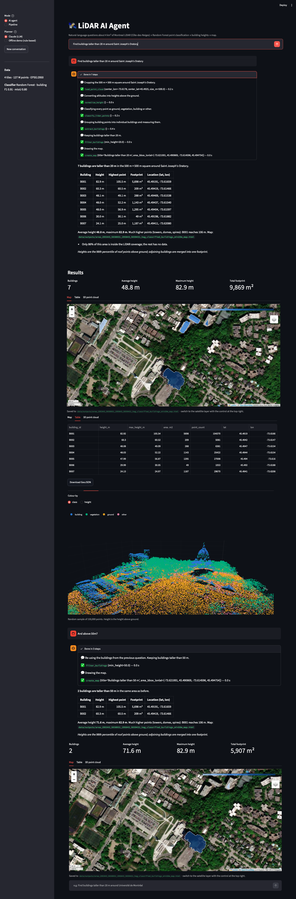
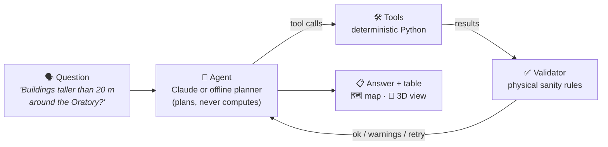
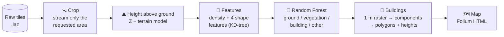
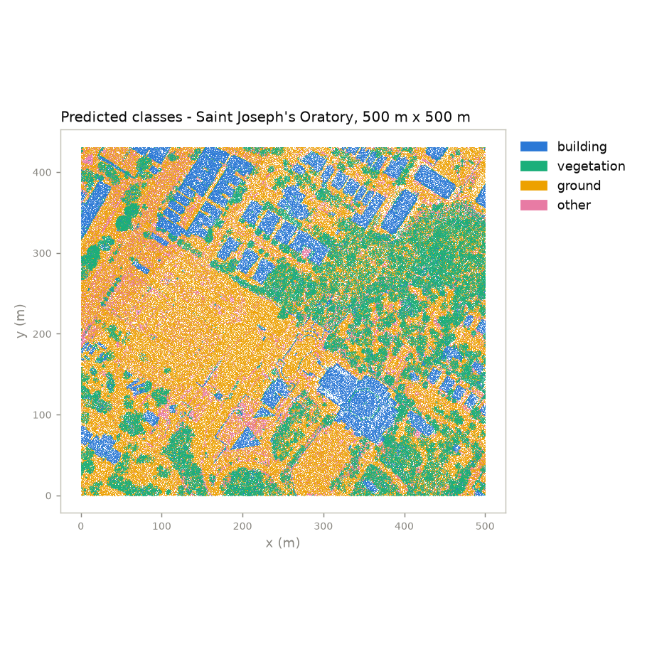
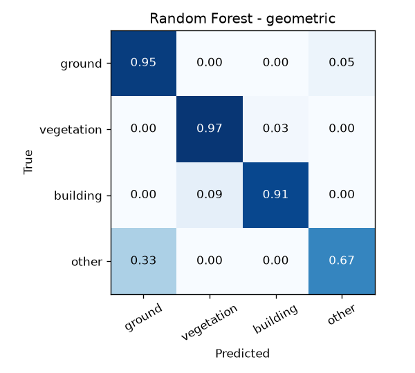
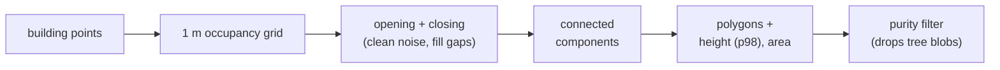
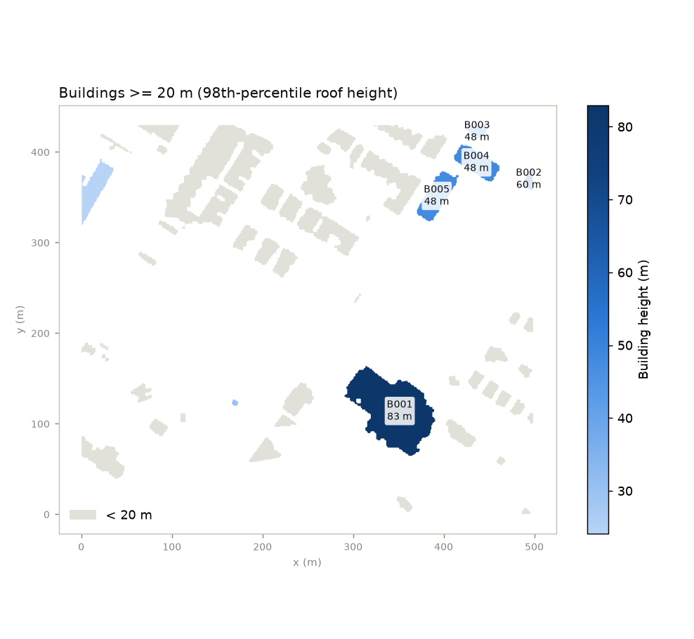
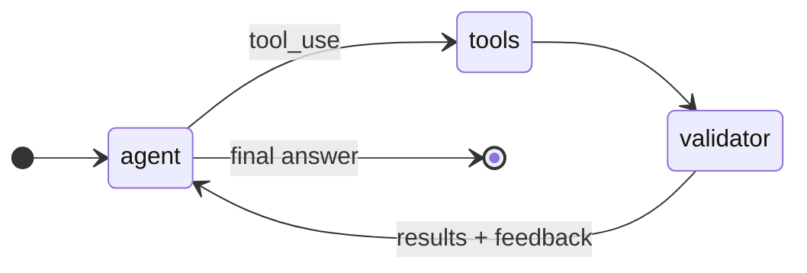
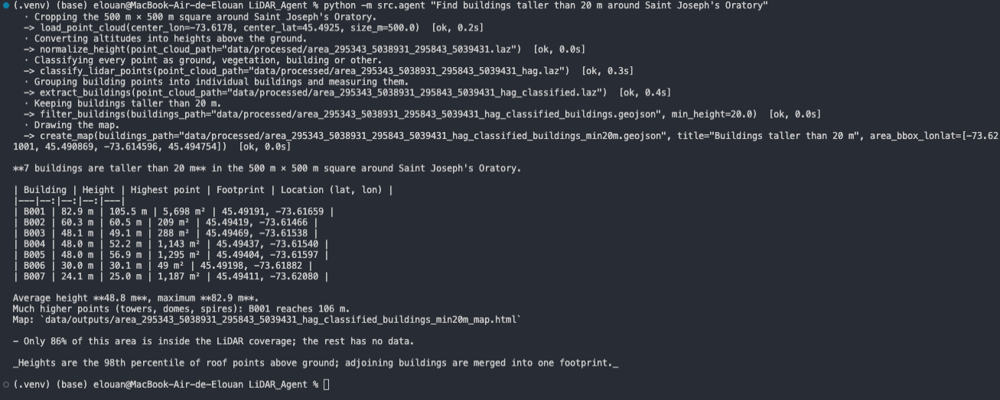
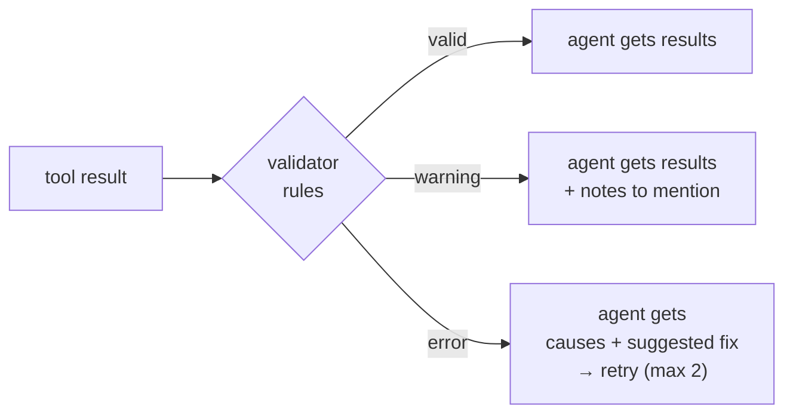

# 🛰️ LiDAR AI Agent

A quick visual tour of the LiDAR AI Agent. Each section links to the detailed doc.

> **In one sentence:** you ask a question about Montreal in plain English, an LLM agent picks and runs a deterministic LiDAR → ML → GIS pipeline, a validator checks every result, and you get an answer, a table and a map.



---

## 1. The big picture



The **LLM only plans and explains**. Every number in the answer comes from a tool, and the validator sees every tool result before the LLM does.

---

## 2. The data 

| | |
|---|---|
| Area | Côte-des-Neiges, Montreal (2 km × 2 km): Université de Montréal, Saint Joseph's Oratory, Mount Royal slope |
| Files | 4 airborne LiDAR tiles, `.laz`, ≈127 M points, 28-35 pts/m² |
| CRS | EPSG:2950 (MTM zone 8, metres) |
| Vendor classes | ground, building, unclassified, noise. **No vegetation class** |

---

## 3. The pipeline, step by step



### Height above ground 

Raw Z is altitude, and the ground here climbs from ≈105 m to 200 m+. So "taller than 20 m" only makes sense after subtracting a terrain model:

```
 altitude Z                          height above ground
   ▲        ┌──┐                       ▲        ┌──┐
   │   ┌──┐ │  │  ← roofs              │   ┌──┐ │  │
   │   │  │ │  │ ╱ ground slope   ──►  │   │  │ │  │
   │   │  │ │ ╱╱                       │   │  │ │  │
   │  ─┴──┴─╱                          │  ─┴──┴─┴──┴──  ground = 0
```

### Classification 

A Random Forest on 9 features per point. The 4 geometric features (linearity, planarity, scattering, verticality) describe whether a point's neighbourhood is a **plane** (roof), a **volume** (tree crown) or a **wall**.



Evaluated on 480,000 points from 8 **held-out 200 m blocks** (spatial split, so neighbours of training points never leak into the test set):

| Features | Accuracy | mIoU | Building F1 | Building IoU |
|---|--:|--:|--:|--:|
| 5 baseline | 0.919 | 0.771 | 0.880 | 0.786 |
| **+ 4 geometric** (deployed) | **0.929** | **0.796** | **0.914** | **0.842** |



### Buildings → [04_building_analysis](04_building_analysis.md)





Compared with the same segmentation run on the vendor's professional classification (held-out blocks):

| Buildings ≥ 100 m² matched | Height diff. (median / p90) | Footprint IoU | Buildings ≥ 20 m found |
|--:|--:|--:|--:|
| 36 / 36 | 0.04 m / 0.33 m | 0.944 | 9 / 9 |

---

## 4. The agent 

A LangGraph state machine with three nodes. Only `agent` involves an LLM.



**7 tools**, each a typed Python function. The JSON schema sent to the LLM is generated from the type hints, and arguments are checked by pydantic before the function runs:

| Tool | Returns |
|---|---|
| `find_lidar_tiles` | tile extents and density |
| `load_point_cloud` | cropped `.laz` (place, bbox or centre + size) |
| `normalize_height` | `.laz` with height above ground + DTM GeoTIFF |
| `classify_lidar_points` | classified `.laz` + class percentages |
| `extract_buildings` | GeoJSON footprints with heights and areas |
| `filter_buildings` | buildings within a height range |
| `create_map` | interactive HTML map |

Tools pass **file paths**, not objects, so every intermediate result can be opened in QGIS and is cached. That makes follow-up questions cheap:

```
you> Find buildings taller than 20 m around Saint Joseph's Oratory
     load → normalize → classify → extract → filter → map      (≈35 s)
you> And above 50 m?
     filter → map                                              (instant, re-uses the buildings file)
```

**Two interchangeable "brains"** behind the same `llm(system, messages, tools)` call:

| | Claude (API key) | Offline demo planner (no key) |
|---|---|---|
| Understands | any phrasing | building-height and coverage questions (regex) |
| Plans | itself | fixed plan |
| Tools, validator, map | real | real |
| Labelled in the UI | Claude | *"Offline demo planner (rule-based, no LLM)"* |



---

## 5. The validator 

An LLM cannot tell that a 648 m "building" is absurd. The validator can.



Examples of rules: `0 < building height < 150 m` for **every** building in the file (not just the 25 shown to the LLM), valid geometries, CRS defined, class percentages summing to 100, height above ground between -2 m and 150 m.

---

## 6. The interface

| Mode | What it does |
|---|---|
| **AI agent** | chat with Claude or the offline planner, live trace of every tool call and validator message |
| **Pipeline** | pick a place, a size and a height threshold with sliders, no agent |

Results panel: metric tiles, interactive map (OpenStreetMap / satellite), building table with GeoJSON download, rotatable 3D point cloud.

---

## 7. Stack and numbers at a glance

| Layer | Tech |
|---|---|
| LiDAR I/O and geometry | laspy, lazrs, NumPy, SciPy (KD-tree, morphology) |
| ML | scikit-learn Random Forest |
| GIS | Rasterio, GeoPandas, Shapely, pyproj |
| Agent | Claude API (Anthropic SDK), LangGraph, pydantic |
| UI | Streamlit, Folium, Plotly |
| Tests | pytest, with scripted fake LLMs (no API key needed) |

| | |
|---|---|
| 500 m × 500 m area (≈10 M points), raw tiles → map | ≈35 s on a MacBook (Apple Silicon) |
| Full 1 km² tile (35 M points) | ≈130 s |
| Model size / training time | 62 MB / 24 s |

## Known limits

- Adjoining buildings (row houses, university wings) merge into one footprint, so counts are lower than a cadastre's.
- Training labels for vegetation are derived by rule (unclassified and > 2 m), so they are weak labels.
- The 150 m height limit must be raised before analysing downtown Montreal.
